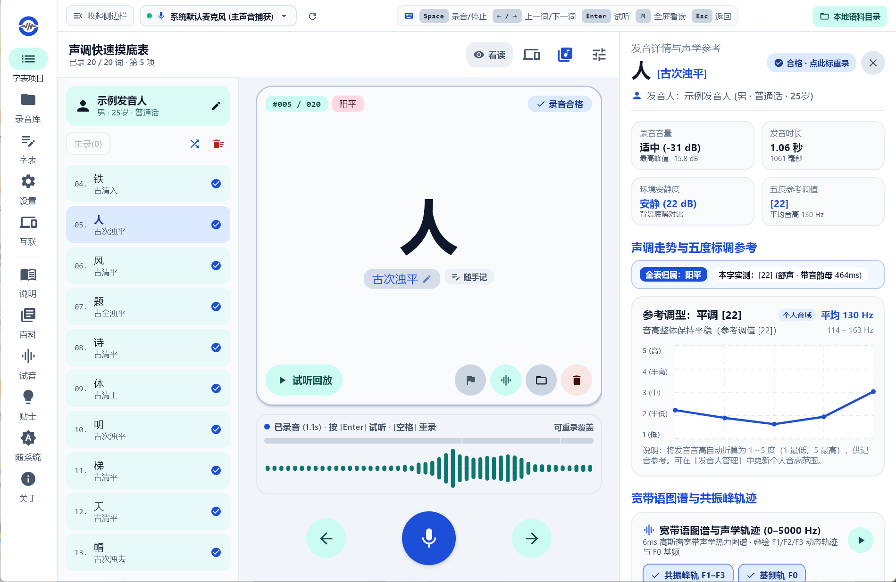
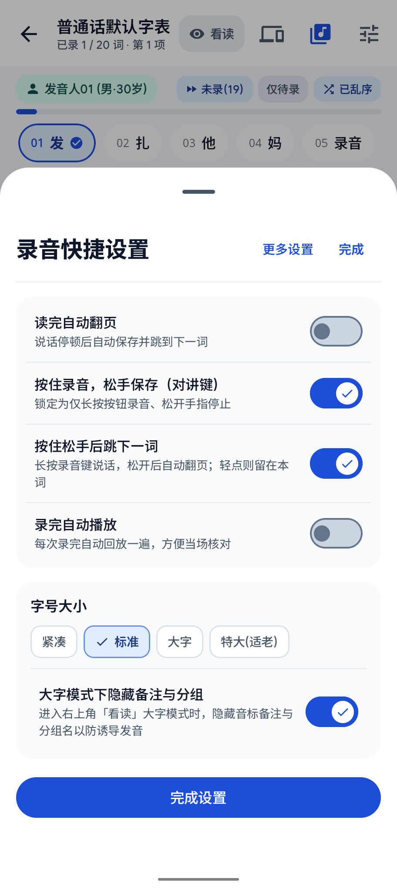
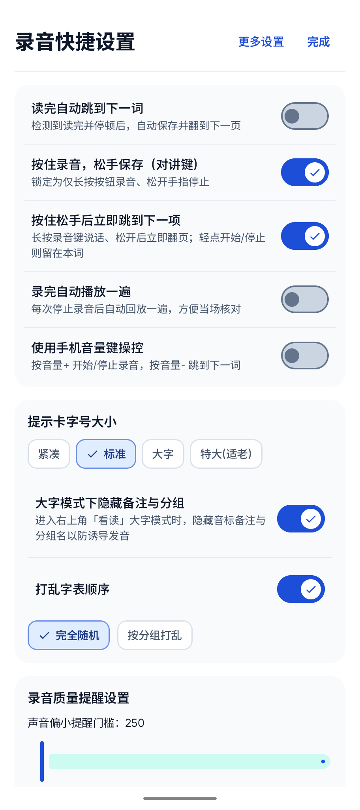

<div align="center">
  
  <h1>PhonAcq</h1>
  <p>田野语音与方言字表采录系统 · 面向方言调查、民族语记音与语音学实验</p>

  <p>
    <a href="https://github.com/KasumiKitsune/PhonAcq/releases/download/v2.0.2/PhonAcq-v2.0.2-windows-x64-setup.exe" title="下载 PhonAcq Windows 桌面版 (64 位 .exe)"></a>
    &nbsp;&nbsp;
    <a href="https://github.com/KasumiKitsune/PhonAcq/releases/download/v2.0.2/PhonAcq-v2.0.2-macos-arm64.dmg" title="下载 PhonAcq macOS 桌面版 (Apple Silicon .dmg)"></a>
    &nbsp;&nbsp;
    <a href="https://github.com/KasumiKitsune/PhonAcq/releases/download/v2.0.2/PhonAcq-v2.0.2-android.apk" title="下载 PhonAcq Android 移动版 (Android 7.0+ .apk)"></a>
  </p>
</div>

> [!NOTE]
> **PhonAcq 相关链接与运行规格**
>
> - **官方主页与交互导览 (GitHub Pages)**：[https://kasumikitsune.github.io/PhonAcq/](https://kasumikitsune.github.io/PhonAcq/)
> - **全部历史版本与校验文件 (Releases)**：[https://github.com/KasumiKitsune/PhonAcq/releases](https://github.com/KasumiKitsune/PhonAcq/releases)
> - **音频与导出规格**：44.1 / 48 kHz 16-bit 无损 PCM WAV · 标准 ZIP / TextGrid / Excel 归档 · 原生衔接 [PhonTracer](https://github.com/KasumiKitsune/PhonTracer) 与 [Praat](https://github.com/KasumiKitsune/praat-simplified-chinese)

| 桌面端三栏主录音台界面 |
| :---: |
| <a href="https://kasumikitsune.github.io/PhonAcq/"></a> |

| 手机端「极简采集模式」 | 手机端「专业分析模式」 |
| :---: | :---: |
|  |  |

---

## 项目简介

在汉语方言调查、民族语田野记音与实验语音学采录中，音频录制之后的重命名归档、静音切分、表格整理与多软件格式转换往往耗费大量精力。

**PhonAcq** 将字表编排、多位发音人对照采录、现场收音质量把关、基础声学参考分析与规范化打包导出整合到同一工作流中，同时支持 **Android 手机 / 平板**、**Windows 桌面端** 与 **macOS（Apple Silicon）桌面端**：

- **同一字表，多人独立建档**：一份调查字表可关联多位发音人，各自的录音文件、进度统计与记音备注独立存储，互不覆盖。
- **兼顾文字与图片引导**：支持常规文字字表与「看图发音」图片词卡混合编排，便于面对不识字或高龄发音人开展田野调查。
- **现场实时把关与声学参考**：录音同时监测输入电平与环境信噪比，自动提示音量过低、削波失真或起止截断；录毕即可查看基频走势、五度参考调值、宽带语图及全表元音分布格局。
- **原生衔接下游分析工具**：可按统一命名规范一键导出 `.zip` 归档包、Praat `.Collection` 集合文件或 [PhonTracer](https://github.com/KasumiKitsune/PhonTracer) `.teproj` 工程包，省去繁琐的手工整理步骤，直接进入下游边界精修与出版级声学制图。

---

## 主要特性概览

> [!TIP]
> **核心工作流能力一览**
>
> | 模块 | 核心功能说明 |
> | :--- | :--- |
> | **双界面模式随心切换** | • **简洁模式**：聚焦字表录音、回放试听与归档导出，隐去声学参数细节，支持「点按录 / 读完自动翻页 / 按住录」与纯净「看读」模式。<br>• **进阶模式**：开放单字宽带语图与共振峰轨迹、全表声调轮廓聚类与调域图、单元音椭圆与复元音动程图（Bark / Hz、多发音人 Lobanov 归一化与宏观报告导出 `.xlsx` + `.png`）、四栏国际音标速记与文白异读派生。<br>• 两种模式可在设置中随时切换，已录音频与元数据完全互通。 |
> | **字表编排与看图诱导** | • 内置汉语方言单字声韵调摸底表、古音清浊声调对照表、普通话连读变调表等模板；支持导入 `.xlsx`、`.docx`、`.csv`、`.tsv`（自动识别 UTF-8 / GBK）、`.txt` 及剪贴板粘贴。<br>• 开启「图片词卡」后支持单条配图、现场拍照，或批量选图按文件名（如 `01_日头_太阳.jpg`）自动建词。<br>• 采用「上图下字」大字排印，支持独立隐去汉字与双指无级缩放图片。 |
> | **田野采录控制与质检** | • 支持音量键 / 键盘盲操控制录音与切词；内置防吞字预录缓冲，降低起音截断风险。<br>• 同一词条支持多遍留存择优与文白异读紧邻派生；开录前可进行环境底噪自检、蓝牙窄带麦提醒与发音人音域校准。<br>• 按发音人独立保存四栏国际音标随手记与自定义音标库。 |
> | **局域网双设备无线联动** | • 无需外网，两台设备处于同一局域网 Wi-Fi 或手机热点即可自动发现、一键连接（无需输入配对码）。<br>• **看读端**（宣纸 / 墨水屏 / 黑板预设）置于发音人面前；**遥控端**由调查人控制切词、切换发音人、起止录音、快捷记音及低延迟耳返监听，并支持开启双设备同步备份与 `录音核对清单.xlsx` 归档。 |
> | **多格式规范导出** | • **标准归档压缩包 (`.zip`)**：无损 `.wav`、同名 `.TextGrid`、原生 `.xlsx`（含表头冻结与自适应列宽，兼容 Excel / WPS / Numbers）、字表清单与备份数据。<br>• **Praat 集合文件 (`.Collection`)**：Sound + TextGrid + Table 打包为单个集合文件，拖入 Praat 一次载入。<br>• **[PhonTracer](https://github.com/KasumiKitsune/PhonTracer) 工程包 (`.teproj`)**：封装音频、分组字表与切分边界，双击即可在 PhonTracer 中继续红线边界微调、橡皮擦散点修整、多发音人统计与出版级图表导出。 |

### 标准导出归档目录结构

```text
项目名称_导出包.zip（进阶模式标准结构）
├── audio/
│   ├── SPK01_001_巴.wav             # 44.1 / 48 kHz 16-bit 单声道无损 PCM 音频
│   ├── SPK01_001_巴.TextGrid        # Praat 对齐标注文件（支持预设或自定义层级）
│   └── takes/                       # 历史重录遍数归档（按需勾选包含）
├── images/                          # 词条配图备份目录（含配图时可包含，支持导回恢复）
├── acoustic_summary.xlsx            # 声学测量、五度参考调值与记音汇总工作簿
├── wordlist.txt                     # 结构化调查字表清单
├── analysis_results.json            # 单字/多音节声学分析明细数据
└── speaker.json / experiment.json   # 发音人档案与项目配置元数据（支持无损导回恢复）
```

---

## 相关项目与工具链联动

PhonAcq 由 [KasumiKitsune](https://github.com/KasumiKitsune) 开发维护，可与以下两个同系列配套工具无缝接力，组成**「现场规范采录 → 声谱精修与批量提参 → 出版制图与深度审校」**的完整语音实验工具链：

- **[PhonTracer — 语音学标注与声学分析桌面套件](https://github.com/KasumiKitsune/PhonTracer)**（[安装包下载](https://github.com/KasumiKitsune/PhonTracer/releases)）  
  基于 Python 与 Praat (Parselmouth) 构建的下游声学精修与制图套件（含 `PhonTracer` 主程序、`Toolkit` 独立工具箱与 `PhonTracerCLI` 命令行工作台），支持声调 `F0` 与元音共振峰 `F1/F2` 双模式分析、声谱图红线边界拖拽与橡皮擦异常散点剔除、多发音人参数隔离、`.ptwl` 高级字表多维重组上色、出版级声学图表（五度图、连读变调全景网、Lobanov 元音空间、Pillai 合并度矩阵等）及研究方法报告导出。**PhonAcq 导出的 `.teproj` 工程包或标准 `.zip` 归档包可直接载入 PhonTracer 接力分析**。

- **[Praat 简体中文汉化版 (praat-simplified-chinese)](https://github.com/KasumiKitsune/praat-simplified-chinese)**  
  语音学标准分析软件 Praat 的简体中文本地化与交互优化维护版本。除提供完整中文界面外，还针对音频播放/暂停切换、按住录音模式、暂存列表自动递增编号等日常操作体验进行了改进，可直接载入 PhonAcq 或 PhonTracer 导出的 `.wav` + `.TextGrid` 及 `.Collection` 集合文件。

---

## 安装与编译运行

普通用户可直接点击页面顶部的平台下载卡片，或前往本仓库 **[Releases](https://github.com/KasumiKitsune/PhonAcq/releases)** 页面下载对应平台安装包：

- **Windows（64 位）**：`PhonAcq-v2.0.2-windows-x64-setup.exe`（Windows 10 / 11 简体中文图形安装向导，支持同版本/跨版本直接覆盖升级，内置运行环境）
- **macOS（Apple Silicon）**：`PhonAcq-v2.0.2-macos-arm64.dmg`（适用于 M1 / M2 / M3 / M4 系列芯片 Mac）
- **Android（手机 / 平板）**：`PhonAcq-v2.0.2-android.apk`（Android 7.0+ 通用）

> [!TIP]
> **macOS 首次打开提示说明**
>
> 首次将应用拖入「应用程序」并双击打开时，若系统弹出安全确认提示，前往 **系统设置 → 隐私与安全性** 底部点击 **「仍要打开」** 即可正常使用（也可在终端执行 `xattr -cr /Applications/PhonAcq.app`）。

### 从源码编译：Android 端
1. 克隆本仓库，使用 **Android Studio (Ladybug 或更新版本)** 打开项目根目录。
2. 确保本地已配置 Android SDK（最低兼容 `minSdk 24` / Android 7.0）。
3. 等待 Gradle 同步完成后，连接真机或模拟器执行 **Run (`:app`)**，或执行 `gradle :app:assembleDebug` 生成安装包。

### 从源码编译：桌面端（Windows & macOS）
1. 确保本地已安装 **JDK 17 或更高版本** 及 **Gradle 8.7+**。
2. 在仓库根目录执行以下命令：
   - 直接启动桌面端：`gradle -p desktop-windows run`
   - 打包 Windows 图形化安装程序 (`.exe`)：`gradle -p desktop-windows packageWindowsSetup -PappVersion=2.0.2`
   - 打包 macOS Apple Silicon 镜像 (`.dmg`)：`gradle -p desktop-windows packageDmg -PappVersion=2.0.2`

### 手动触发多端自动发版（GitHub Actions）
仓库内置手动发版工作流 `.github/workflows/release.yml`（不会在日常 `git push` 时自动运行）：
1. 在 GitHub 仓库顶部进入 **Actions → Release PhonAcq (Android APK · Windows EXE · macOS DMG)**，点击 **Run workflow**，填写版本号（如 `2.0.2`）与更新说明即可一键并行构建并发布 Release。
2. **可选 Android 正式签名配置**：在仓库 **Settings → Secrets and variables → Actions** 中添加以下三个 Secret，工作流即会自动产出正式签名版 `PhonAcq-v2.0.2-android.apk`（未配置时自动回退生成可安装的测试签名版）：
   - `ANDROID_KEYSTORE_BASE64`：别名为 `upload` 的 `.jks` 签名文件经 Base64 编码后的单行文本（可通过 `keytool -genkeypair -v -keystore upload-key.jks -alias upload -keyalg RSA -keysize 2048 -validity 10000` 生成后执行 `base64 -w 0 upload-key.jks` 获取）
   - `STORE_PASSWORD`：Keystore 密码
   - `KEY_PASSWORD`：`upload` 密钥密码

---

## 数据存储与跨设备迁移

所有录音原声、词条配图、调查字表与发音人资料均直接保存在当前设备中，在无网络的乡村田野也可正常录音、分析与导出。如需备份或迁移至其他电脑/手机，导出标准 `.zip` 项目压缩包并在目标设备导入即可完整恢复。

