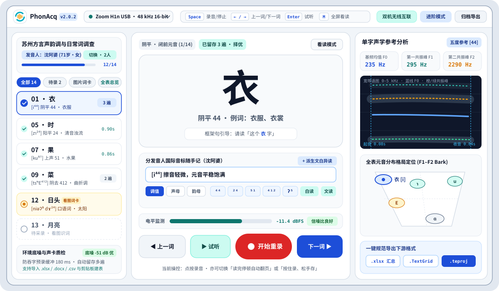

<div align="center">

# PhonAcq · 田野语音与方言字表采录系统

面向方言调查、语音学实验与课堂记音训练的本地化语音采录与归档工具

-2563EB?style=flat-square)


[**在线体验交互式工作台导览（GitHub Pages）→**](https://kasumikitsune.github.io/PhonAcq/) · [**下载最新安装包（Releases）→**](https://github.com/KasumiKitsune/PhonAcq/releases/latest)

<br/>

<a href="https://kasumikitsune.github.io/PhonAcq/">
  
</a>

</div>

---

## 项目简介

在汉语方言调查、民族语田野记音与实验语音学采录中，音频录制之后的重命名归档、静音切分、表格整理与多软件格式转换往往耗费大量精力。

**PhonAcq** 将字表编排、多位发音人对照采录、现场收音质量把关、基础声学参考分析与规范化打包导出整合到同一工作流中，同时支持 Android 手机/平板、Windows 桌面端与 macOS（Apple Silicon）桌面端：

- **同一字表，多人独立建档**：一份调查字表可关联多位发音人，各自的录音文件、进度统计与记音备注独立存储，互不覆盖。
- **兼顾文字与图片引导**：支持常规文字字表与「看图发音」图片词卡混合编排，便于面对不识字或高龄发音人开展田野调查。
- **现场实时把关与声学参考**：录音同时监测输入电平与环境信噪比，自动提示音量过低、削波失真或起止截断；录毕即可查看基频走势、五度参考调值、宽带语图及全表元音分布格局。
- **原生衔接下游分析工具**：可按统一命名规范一键导出 `.zip` 归档包、Praat `.Collection` 集合文件或 PhonTracer `.teproj` 工程包，省去繁琐的手工整理步骤。

---

## 主要特性

### 1. 简洁与进阶双界面模式
- **简洁模式**：聚焦字表录音、回放试听与归档导出，隐去声学参数细节，支持「点按录 / 读完自动翻页 / 按住录」及纯净「看读」引导模式，适合课程作业采录或初次接触田野调查的使用者快速上手。
- **进阶模式**：开放单字宽带语图与共振峰轨迹、全表声调轮廓聚类与调域图、单元音椭圆与复元音动程图（支持 Bark / Hz 标度、多发音人 Lobanov 声道归一化对比及一键导出宏观报告 `.xlsx` + `.png`）、四栏国际音标速记、现场派生文白异读词条以及自定义 TextGrid 层级配置。
- 两种模式可随时在设置中切换，已录音频与项目元数据完全互通。

### 2. 字表管理与图片词卡（看图发音）
- **多渠道建表**：内置汉语方言单字声韵调摸底表、古音清浊声调对照表、普通话连读变调表等常用模板；支持直接导入 `.xlsx`、`.docx`、`.csv`、`.tsv`（自动识别 UTF-8 与 GBK 编码）及 `.txt` 文件，也支持从剪贴板粘贴文本并自动识别分组与注释。
- **按需配图与批量建词**：开启项目的「图片词卡」选项后，可对任意词条单独选图、现场拍照配图，或一次性多选图片按文件名（如 `01_日头_太阳.jpg`）自动创建词条并完成配图，未配图词条仍按常规文字展示。
- **适配长辈看读体验**：录音台与无线看读端默认采用「上图下字」布局，点击顶栏「看读」可一键放大目标字并按需独立显隐汉字与词表提示，减少字面诱导；配图区域支持双指捏合无级放大、拖动平移与双击还原。

### 3. 面向田野现场的采录控制与质检
- **低干扰操控**：支持「点按录音」「读完停顿自动翻页」与「按住录、松手存」三种操控方式，可通过手机音量键或桌面端键盘快捷键盲操控制录音与切词，减少触屏/鼠标点击杂音；内置防吞字预录缓冲，降低起音截断风险。
- **多遍留存择优与文白异读派生**：同一词条重复录制时自动保留多遍历史录音，可随时试听对比并指定正式采用版本；遇到文白两读或又音时，可在记音或多遍管理弹窗中直接派生紧邻的异读词条。
- **试音、输入源检查与音域校准**：提供开录前环境底噪评估与试录自检，检测到蓝牙窄带通话麦克风接入时自动发出提示；发音人音域支持后台自适应测算，也支持手动微调基频上下限。
- **分发音人国际音标随手记**：内置调值、声母、韵母、常用标签四栏快捷输入面板（支持光标处插入与自定义方言音标库），记音结果按发音人独立保存。

### 4. 局域网双设备无线联动
- 在无互联网的田野环境下，两台设备只需接入同一局域网 Wi-Fi 或手机热点，即可通过六位配对码组成 **看读端** 与 **遥控端**。
- **看读端**：置于发音人面前，提供温和宣纸、电子墨水屏、高对比黑板等视觉预设，支持字号缩放、看图词卡同步展示与「中场休息」界面，可按需锁定或开放发音人自主翻页权限。
- **遥控端**：由调查人手持控制切词、切换发音人或项目、起止录音、光标处快捷记音，并支持低延迟无线实时耳返监听与独立会话胶囊归档（含原生 `录音核对清单.xlsx`）。

### 5. 多格式规范导出
支持自定义音频文件命名规则、按发音人分目录结构与无损备份导回，提供三种主要导出形式：
- **标准归档压缩包 (`.zip`)**：包含无损 `.wav` 音频、同名 `.TextGrid` 标注文件、原生 Excel 工作簿 `.xlsx`（双击即可在 Excel / WPS / Numbers 及 `openpyxl` / `readxl` 中直读，含表头冻结与自适应列宽）、结构化字表清单，以及可选的词卡配图与历史重录遍数备份。简洁模式下自动输出中文纯净目录与双工作表 `录音汇总表.xlsx`。
- **Praat 集合文件 (`.Collection`)**：将配对的 Sound、TextGrid 与汇总 Table 封装为单个二进制或文本集合文件，拖入 Praat 即可一次性载入全部对象。
- **PhonTracer 工程包 (`.teproj`)**：封装音频、词表分组元数据与自动切分的起止边界信息，可在 PhonTracer 中直接打开进行边界微调与批量特征提取。

```text
项目名称_导出包.zip（进阶模式标准结构）
├── audio/
│   ├── SPK01_001_巴.wav             # 44.1 / 48 kHz 16-bit 单声道无损 PCM 音频
│   ├── SPK01_001_巴.TextGrid        # Praat 对齐标注文件（支持预设或自定义层级）
│   └── takes/                       # 历史重录遍数归档（按需勾选包含）
├── images/                          # 词条配图备份目录（含配图时可包含，支持导回恢复）
├── acoustic_summary.xlsx            # 声学测量、五度参考调值与记音汇总工作簿
├── wordlist.txt                     # 结构化调查字表清单
├── analysis_results.json            # 单字/多音节声学分析明细数据
└── speaker.json / experiment.json   # 发音人档案与项目配置元数据（支持无损导回恢复）
```

---

## 相关项目（同作者工具链）

PhonAcq 由 [KasumiKitsune](https://github.com/KasumiKitsune) 开发维护，可与以下两个同作者开源项目配合组成从「现场采录」到「边界精修与特征提取」再到「声学分析制图」的完整工作流：

- **[PhonTracer](https://github.com/KasumiKitsune/PhonTracer)**  
  基于 Python 与 Praat (Parselmouth) 构建的语音声调（基频）与共振峰特征批量提取工具，支持长音频自动切分与独立音频匹配、声谱图可视化边界微调及标准化声学数据导出。PhonAcq 导出的 `.teproj` 工程包与四层兼容标注可直接由 PhonTracer 读取。

- **[Praat 简体中文汉化版 (praat-simplified-chinese)](https://github.com/KasumiKitsune/praat-simplified-chinese)**  
  语音学标准分析软件 Praat 的简体中文本地化与交互优化维护版本。除提供完整中文界面外，还针对音频播放/暂停切换、按住录音模式、暂存列表自动递增编号等日常操作体验进行了改进，可直接载入 PhonAcq 导出的 `.wav` + `.TextGrid` 或 `.Collection` 文件。

---

## 安装与编译运行

普通用户可直接前往本仓库右侧 **[Releases](https://github.com/KasumiKitsune/PhonAcq/releases)** 页面下载对应平台的安装包：
- **Android（手机 / 平板）**：`PhonAcq-vX.Y.Z-android.apk`（Android 7.0+）
- **Windows（64 位）**：`PhonAcq-vX.Y.Z-windows-x64-setup.msi`（Windows 10 / 11，内置运行环境）
- **macOS（Apple Silicon）**：`PhonAcq-vX.Y.Z-macos-arm64.dmg`（适用于 M1 / M2 / M3 / M4 系列芯片 Mac；首次打开若提示无法验证开发者，可在「系统设置 → 隐私与安全性」底部点击「仍要打开」，或在终端执行 `xattr -cr /Applications/PhonAcq.app`）

### 从源码编译：Android 端
1. 克隆本仓库，使用 **Android Studio (Ladybug 或更新版本)** 打开项目根目录。
2. 确保本地已配置 Android SDK（最低兼容 `minSdk 24` / Android 7.0）。
3. 等待 Gradle 同步完成后，连接真机或模拟器执行 **Run (`:app`)**，或执行 `gradle :app:assembleDebug` 生成安装包。

### 从源码编译：桌面端（Windows & macOS）
1. 确保本地已安装 **JDK 17 或更高版本** 及 **Gradle 8.7+**。
2. 在仓库根目录执行以下命令：
   - 直接启动桌面端：`gradle -p desktop-windows run`
   - 打包 Windows 安装程序 (`.msi`)：`gradle -p desktop-windows packageMsi -PappVersion=2.0.1`
   - 打包 macOS Apple Silicon 镜像 (`.dmg`)：`gradle -p desktop-windows packageDmg -PappVersion=2.0.1`

### 手动触发多端自动发版（GitHub Actions）
仓库内置手动发版工作流 `.github/workflows/release.yml`（不会在日常 `git push` 时自动运行）：
1. 在 GitHub 仓库顶部进入 **Actions → Release PhonAcq (Android APK · Windows MSI · macOS DMG)**，点击 **Run workflow**，填写版本号（如 `2.0.1`）与更新说明即可一键并行构建并发布 Release。
2. **可选 Android 正式签名配置**：在仓库 **Settings → Secrets and variables → Actions** 中添加以下三个 Secret，工作流即会自动产出正式签名版 `PhonAcq-vX.Y.Z-android.apk`（未配置时自动回退生成可安装的测试签名版）：
   - `ANDROID_KEYSTORE_BASE64`：别名为 `upload` 的 `.jks` 签名文件经 Base64 编码后的单行文本（可通过 `keytool -genkeypair -v -keystore upload-key.jks -alias upload -keyalg RSA -keysize 2048 -validity 10000` 生成后执行 `base64 -w 0 upload-key.jks` 获取）
   - `STORE_PASSWORD`：Keystore 密码
   - `KEY_PASSWORD`：`upload` 密钥密码

---

## 数据与隐私说明

PhonAcq 采用纯本地离线架构。所有录音音频、词条配图、调查字表、发音人背景资料及声学计算均在本地设备完成并保存在本地存储空间中；双机无线联动仅通过本地局域网直连传输，应用不会向任何外部服务器上传语料或个人信息。
